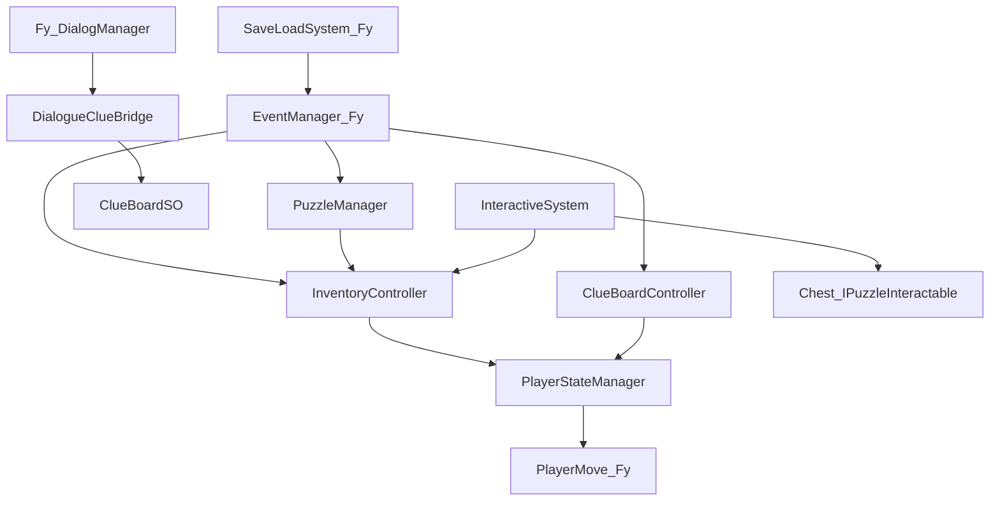

# 2025GuoMei

> 国美毕设协作的 **Unity 2D URP 叙事探索 Demo**：在探索流程中把「道具收集 → 线索推理 → 拼图奖励回写」做成可配置、可存档、可对接主流程的玩法模块。

本仓库是**作品集 / 学习向**公开版。下文以作者主责的三套系统（背包、线索板、拼图）说明工程设计；对话、存档框架、场景流等由队友实现，见 [项目背景](#项目背景) 与 [协作分工](#协作分工与个人贡献)。

## 项目背景

本项目是与**中国美术学院（国美）同学**协作完成的**毕业设计**。团队按美术 / 策划 / 程序分工；作者以**程序策划**身份参与，负责把玩法需求落地为数据驱动、可存档、能接入主流程的系统。

个人主责代码集中在 [`Assets/Lrb_Assets`](Assets/Lrb_Assets)：**背包（InventorySystem）**、**线索板（ClueBoard）**、**拼图（PinTu）** 及对应 `_Data` 配置。队友实现的存档与对话层（[`Assets/Fy_Assets`](Assets/Fy_Assets) 等）通过公开接口和 `EventManager` 的 Save / Load 事件对接，不是单人全栈。

[](https://unity.com/releases/editor/whats-new/2021.3.45)
[](https://learn.microsoft.com/dotnet/csharp/)
[](https://docs.unity3d.com/Packages/com.unity.render-pipelines.universal@14.0/manual/index.html)
[](https://docs.unity3d.com/Packages/com.unity.inputsystem@1.14/manual/index.html)
[](https://docs.unity3d.com/Packages/com.unity.cinemachine@2.10/manual/index.html)
[](https://docs.unity3d.com/Packages/com.unity.textmeshpro@3.0/manual/index.html)
[](https://www.newtonsoft.com/json)
[](http://dotween.demigiant.com/)
[](https://odininspector.com/)

---

## 核心特性

不罗列「有背包 / 有拼图」，只写三套系统里有设计取舍的点。

1. **数据驱动背包 + 读档重连引用**  
   [`InventorySO`](Assets/Lrb_Assets/Scripts/InventorySystem/Model/InventorySO.cs) 把格子状态存在 `inventoryItems`；存档只带可序列化字段（含 `itemID`）。读档后必须走 `LoadDataFromSave(ItemDatabaseSO)`，用 ID 把 `ItemSO` 引用补回去，再 `InformAboutChange()` 刷新 UI。[`InventoryController`](Assets/Lrb_Assets/Scripts/InventorySystem/InventoryController.cs) 订阅 `EventNameEnum.Save / Load`，把列表同步进 `GameData.bagData.bagContent`。

2. **物品行为用接口拆开，而不是巨型 Item 类**  
   抽象基类 [`ItemSO`](Assets/Lrb_Assets/Scripts/InventorySystem/Model/ItemSO.cs) 定义堆叠、`ItemID`、描述和图标；行为靠 `IItemAction` / `IDestroyableItem` / `IDroppableItem`。现有子类：[`ConsumptiveInteractionItemSO`](Assets/Lrb_Assets/Scripts/InventorySystem/Model/ItemChildren/ConsumptiveInteractionItemSO.cs)（`Use` 后调 `InteractiveSystem.TrySolvePuzzle`）、[`EquippableItemSO`](Assets/Lrb_Assets/Scripts/InventorySystem/Model/ItemChildren/EquippableItemSO.cs)（`Equip`）。场景侧由 [`InteractiveSystem`](Assets/Lrb_Assets/Scripts/InventorySystem/Interactive/InteractiveSystem.cs) 处理拾取与 `IPuzzleInteractable`（如 [`Chest`](Assets/Lrb_Assets/Scripts/Chest.cs)）。对外入包：`AddItemToInventory(ItemEnum / string / ItemSO, …)`。

3. **线索板「状态叠加」存档**  
   [`ClueBoardSO.ExportSaveData`](Assets/Lrb_Assets/Scripts/ClueBoard/Model/ClueBoardSO.cs) 只导出已收集线索（`clueID / isRead / runtimePos`）。`ImportSaveData` 先 `ResetToDefaultState()`，再叠 `GameData.collectedClues` 与 `finishedChains`，避免 ScriptableObject 上残留上一局的 `isCollected`。

4. **推理链：数据判定与演出分离**  
   点击节点走 [`ClueBoardController.HandleClueNodeRequest`](Assets/Lrb_Assets/Scripts/ClueBoard/ClueBoardController.cs)：`SetClueAsRead` → `CheckChainCompletion`。命中链后 `PlayDeductionSequence` 协程播放 `UIClueBoard.PlayChainAnimation`，用 `IsAnimating` + `CanvasGroup.interactable` 锁交互；连线中途回调再 `TryCollectClue` 激活终点，最后 `MarkChainAsAnimated`。全部线索已读时调用队友的 `SystemEventManager.SomeOneHasDown(5)`。

5. **对话只碰桥，不进线索板内部**  
   [`DialogueClueBridge.OnDialogueEvent(EClueLink | string)`](Assets/Lrb_Assets/Scripts/ClueBoard/BridgeOthers/DialogueClueBridge.cs) 用 `ClueDatabaseSO.GetClueByLink` 匹配后调用 `TryCollectClue`。对话 CSV 与 `Fy_DialogManager` 由队友维护；桥接脚本只翻译事件，不承担 UI 流程。

6. **拼图关卡全 SO 配置，跨场景静态注入**  
   [`PuzzleLevelData`](Assets/Lrb_Assets/Scripts/PinTu/PuzzleLevelData.cs) 配整图、切块 Sprite、正确局部坐标、吸附阈值，以及多块 `ScatterArea`（`evenDistribution` 轮询 / 随机）。[`PuzzleManager.NextLevelToLoad`](Assets/Lrb_Assets/Scripts/PinTu/PuzzleManager.cs) 供切场景前指定关卡；`Start` 优先吃静态字段。已有配置：`HuaChe` / `JiuLou` / `QiE` / `ZhuLongFu`。构建场景实际进的是 `PinTu_HuaChe` / `PinTu_JiuLou` / `PinTu_House`。

7. **拼图交互、层级与结算回写主流程**  
   [`PuzzlePiece`](Assets/Lrb_Assets/Scripts/PinTu/PuzzlePiece.cs) 用吸附阈值锁定；拖拽前 `DOKill()`，销毁时再杀一遍 Tween。`sortingOrder` 分 `baseOrder / draggingOrder / lockedOrder`。胜利后统一层级、底图闪烁、碎片欢呼、DOTween 弹出返回按钮；`OnClickReturnToMainGame` 先 `SaveLoadSystem.SaveGame()`，再 `SmoothLoadingScreen.StartLoadingScene("PersistentScenes")`。奖励走 `InventoryController.AddItemToInventory`（`GuDingChouMa` 消耗规则未做完，见 [未来计划](#未来计划)）。

---

## 架构设计

### 模块关系

三套玩法控制器都挂在队友的存档总线上，自己不写磁盘。新玩法背包以 Lrb `InventoryController` 为准；`Fy_Assets/Script/BigBag` 是旧实现，仅兼容。



数据层在 [`Assets/Lrb_Assets/_Data`](Assets/Lrb_Assets/_Data)：`Inventory` / `ClueBoard` / `PinTu`。运行时逻辑在 `Scripts`，配置不塞进场景硬编码。

### 关键设计决策

| 决策 | 为什么 | 权衡 |
|------|--------|------|
| ScriptableObject 做配置，运行时 List 做状态 | 策划能在 `_Data` 改道具 / 线索 / 关卡，不必改代码 | Unity 不会自动重连序列化后的 `ItemSO` / `ClueSO` 引用，读档必须显式查库（`itemID` / `clueID`） |
| 观察者：`EventManager` + SO 内 `Action` | 对齐队友全局 Save / Load，三模块不依赖 `SaveLoadSystem` 内部实现 | `EventNameEnum` 只有 Save / Load；其它跨系统通信仍走队友的 `EventHandler` / `SystemEventManager` |
| 拼图用静态字段 `NextLevelToLoad` | 对话或场景脚本切到 `PinTu_*` 时不必 `FindObjectOfType` | 切完场景若不清理，存在串关风险，调用方要自己约定生命周期 |

### 设计模式与代码落点

- **观察者**：`EventManager` 广播存档；`InventorySO.OnInventoryUpdated`、`ClueBoardSO.OnClueBoardUpdated` 推 UI。
- **单例（MonoBehaviour）**：`InventoryController` / `ClueBoardController` / `PuzzleManager`。
- **桥接**：`DialogueClueBridge` 隔离 `Fy_DialogManager` 与 `ClueBoardSO`。
- **策略式物品行为**：`IItemAction.PerformAction`，子类各自实现 Use / Equip。
- **协程状态锁**：`PlayDeductionSequence` 期间 `IsAnimating`，避免连线被二次点击打断。

---

## 演示

**完整流程录像（B 站）：** [https://www.bilibili.com/video/BV1GbGy6LEzm](https://www.bilibili.com/video/BV1GbGy6LEzm)

<!-- GIF: 背包开关（Alpha1）、拖拽换位、场景拾取入包 -->
<!-- GIF: 线索板打开（Alpha2）、点击节点、推理链连线与终点激活 -->
<!-- GIF: 拼图拖拽吸附、胜利 UI、返回 PersistentScenes -->
<!-- 截图: PersistentScenes 主探索界面 -->
<!-- 截图: 客栈内对话 / 线索反馈 -->

本地补图后，把上面的 HTML 注释换成：

```markdown


```

---

## 运行方式

### 环境

- **Unity 2021.3.45f2c1**（见 [`ProjectSettings/ProjectVersion.txt`](ProjectSettings/ProjectVersion.txt)）
- 渲染：**URP 14.0.12** + 2D Renderer
- 用 Unity Hub 打开仓库**根目录**。首次打开会生成 `Library/`（已在 [`.gitignore`](.gitignore) 排除）

### 关键 Package（`Packages/manifest.json`）

官方：`com.unity.render-pipelines.universal` 14.0.12、`com.unity.inputsystem` 1.14.0、`com.unity.cinemachine` 2.10.3、`com.unity.textmeshpro` 3.0.7、`com.unity.nuget.newtonsoft-json` 3.2.2、`com.unity.feature.2d` 2.0.1。

工程内第三方（不在 manifest 徽章里）：**DOTween**、**Odin Inspector**、**Spine**、**A\* Pathfinding Project**。权利归原作者，二次分发前请读各自许可。

### 打开与运行

1. Unity Hub → Open → 选本仓库根目录。
2. 等脚本编译结束。
3. Build Settings 首场景是 [`Assets/Scenes/Start.unity`](Assets/Scenes/Start.unity)。从该场景 Play。
4. 构建顺序大致为：`Start` → `PersistentScenes` → `ChuPu` → `PinTu_House` / `PinTu_HuaChe` / `PinTu_JiuLou` → `客栈内` → `客栈内_触发花车后` → `拆分内容/{上方,右侧,左侧,花车}`。

调试快捷键（运行时）：

| 键 | 行为 | 落点 |
|----|------|------|
| `Alpha1` | 开关背包 | `InventoryController.Toggle` |
| `Alpha2` | 开关线索板 | `ClueBoardController.Toggle` |
| `Alpha3` | 拼图一键通关（调试） | `PuzzleManager.AutoCompleteLevel` |
| `E` | 场景拾取 / 交互 | `InteractiveSystem.HandlePrimaryInteract` |

### 克隆后你会看到 Missing

[`.gitignore`](.gitignore) 排除了大量美术与音频，例如 `Assets/Art/`、`资产迭代完成版/`、`png/`、`Fy_Assets/Art/`、`Lrb_Assets/UI国美资产/`、`_Graphics/`、`Audio/` 等。克隆后贴图 / 字体 / 音效引用会 Missing。**逻辑脚本和 `_Data` 下的 ScriptableObject 仍在**，适合读架构；完整画面需作者本机资源。公开仓库按学习 / 备份用途理解，不要当商用素材库。

---

## 性能与踩坑

都是这三套系统开发时真实碰到的问题，不是清单式「用了对象池」。

- **读档只恢复 ID、不重连 `ItemSO`**  
  `InventorySO.LoadDataFromSave` 对「有数量但 `itemID` 为空」和「库中无此 ID」打 Warning / Error。旧存档缺 ID 时需要删档重开（脚本注释已写明）。漏掉这一步，UI 图标和后续 `AddItem` 会空引用。

- **线索 Import 必须先 Reset**  
  ScriptableObject 在编辑器里会记住运行时改过的 `isCollected`。`ImportSaveData` 先 `ResetToDefaultState()` 再叠加存档，否则会出现「没读档也带着上一 Play 的线索」。

- **DOTween 比 GameObject 活得更久**  
  `PuzzlePiece` 在 `OnMouseDown` / `InstantSnap` / `OnDestroy` 里 `DOKill()`。否则销毁碎片或重开关卡后，Tween 仍写 `transform` 报空。

- **拼图 Sorting Order 会「鼓边」**  
  拖拽抬高层级、锁定降回 `lockedOrder`；`HandleVictory` 再把所有碎片统一到同一 plane，避免完成图边缘互相抢层级。

- **移动锁没有全项目统一（集成风险）**  
  背包 / 线索板开关走 [`PlayerStateManager.SetMovementLock`](Assets/Lrb_Assets/Scripts/PlayerStateManager.cs) 关 `PlayerMove.enabled`。队友部分脚本仍直接改 `PlayerMove.canMove`。新功能应走 `PlayerStateManager`，不要再分叉。

- **交互候选用脏标记，而不是每帧 Overlap**  
  `InteractiveSystem` 用 `HashSet` 记 Trigger 进出，`m_candidatesDirty` 为真才重算最近物。`reserveNonAllocBuffer` 是预留的 NonAlloc 缓冲，**默认关闭**，没有当成已上线的主优化。

---

## 协作分工与个人贡献

| 范围 | 谁 | 内容 |
|------|----|------|
| 毕设整体 | 国美协作团队 | 叙事、场景、美术、对话 CSV、主菜单与切场景、棋牌（ChuPu）等 |
| 存档框架 | 队友（`Fy_Assets`） | `SaveLoadSystem`、`EventManager`、`GameData`、`SmoothLoadingScreen` |
| 对话运行时 | 队友 | `Fy_DialogManager` 等 |
| **程序策划（作者）** | **Lrb_Assets** | **`InventoryController` 全链路**、**`ClueBoardController` + `ClueBoardSO` 推理与存档**、**`PuzzleManager` + `PuzzleLevelData`**；配置在 `_Data/Inventory`、`_Data/ClueBoard`、`_Data/PinTu` |
| 线索板对接对话 | 作者（集成必要件） | `DialogueClueBridge`：把对话事件翻译成 `TryCollectClue` |
| 旧背包 | 队友遗留 | `Fy_Assets/Script/BigBag`，新玩法不要往这里加 |

`ObserveMode`、自研 A\* NPC、玩家移动状态机等也在仓库里，**不是本 README 所述的个人主责**，不展开实现。

生成物：[`ItemEnum.cs`](Assets/Lrb_Assets/_Data/Inventory/Items/ItemEnum.cs) 文件头写明由菜单 `Tools/Inventory/Generate Item Enums` 生成、勿手改。当前仓库只有该生成结果；对应 Editor 脚本源码未一并提交。

---

## 未来计划

代码里已标明、但**还不能写成已完成**的部分：

- [`PuzzleManager`](Assets/Lrb_Assets/Scripts/PinTu/PuzzleManager.cs)：`GuDingChouMa` 旁注释「玩拼图需要筹码？获取多少筹码？」——消耗 / 入场规则未设计完；当前胜利结算是**发放**固定筹码。
- [`DialogueClueBridge`](Assets/Lrb_Assets/Scripts/ClueBoard/BridgeOthers/DialogueClueBridge.cs) 顶部 Todo：视觉反馈还要向 `ItemDesClueInteractable` 一类表现看齐。
- [`UIClueBoard`](Assets/Lrb_Assets/Scripts/ClueBoard/UI/UIClueBoard.cs)：终点「不激活但连线 + 画圈」、部分连线音效、移除线索时反向清节点等仍是 TODO。

---

## 授权与第三方

**版权所有 © 阿彬。保留一切权利。**

| 允许 | 禁止 |
|------|------|
| 个人学习、研究、非收费教学演示 | 任何商业用途（收费发布、广告 / 内购变现、出售源码或资源等） |
| 本地修改与调试 | 删除或篡改 `LICENSE` 与版权说明 |
| 注明出处后分享学习向 Demo（须同样非商用） | 未获书面授权再授权给他人 |

完整条款见 **[LICENSE](./LICENSE)**。商用合作：[llrbking0@gmail.com](mailto:llrbking0@gmail.com)。

第三方（Spine、DOTween、Odin、A\* 等）权利归原作者，本许可不替代其条款。

---

## 延伸阅读

- [docs/LRB_DEVELOPMENT_GUIDE.md](docs/LRB_DEVELOPMENT_GUIDE.md) — `Lrb_Assets` 开发约定（背包 / 线索板 / 拼图的存档与接口）
- [docs/国美_项目结构盘点.md](docs/国美_项目结构盘点.md) — 全仓库模块边界与风险（含队友系统，接手用）
