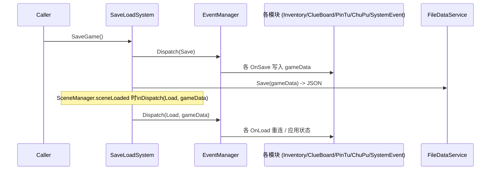
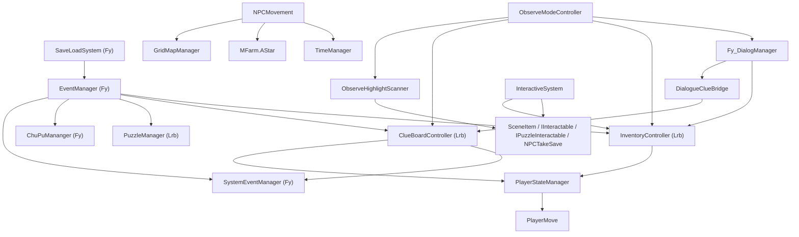

# 国美 项目结构盘点（只读版，不改代码）

> 本文档为项目整体速读手册，与 Cursor 计划「国美 项目结构盘点」内容一致；请勿与 `.cursor/plans/` 内同名计划文件混为一谈（计划文件由工具维护，本文件为仓库内稳定副本）。

## 1. 引擎与技术栈

- **引擎版本**: Unity `2021.3.45f2c1` LTS（[ProjectSettings/ProjectVersion.txt](../ProjectSettings/ProjectVersion.txt)）。
- **渲染管线**: Universal RP `12.1.15`，使用 2D Renderer，BlendStyles 顺序固定为 `0=Multiply / 1=Additive / 2=MultiplyMask / 3=AdditiveMask`，配置在 [Assets/other/Settings/UniversalRP_Renderer.asset](../Assets/other/Settings/UniversalRP_Renderer.asset)。
- **关键官方包**（[Packages/manifest.json](../Packages/manifest.json)）：
  - `com.unity.feature.2d 2.0.1`、`com.unity.cinemachine 2.10.3`、`com.unity.timeline`
  - `com.unity.inputsystem 1.7.0`（同时存在老 `Input.GetKeyDown` 写法）
  - `com.unity.nuget.newtonsoft-json 3.2.2`（线索板存档用 Json.NET）
  - `com.unity.textmeshpro 3.0.6`
- **第三方插件**（[Assets/other/Plugins](../Assets/other/Plugins)）：
  - **Sirenix Odin Inspector**（普遍使用 `[Header]/[BoxGroup]/[Required]/[LabelText]/[InlineProperty]`）
  - **DOTween (Demigiant)**（拼图、UI、ItemFader 动画）
  - **Spine for Unity**（NPC/角色动画备用）
  - **AstarPathfindingProject**（位于 [Assets/AstarPathfindingProject](../Assets/AstarPathfindingProject)，但项目自己也写了一套 `MFarm.AStar` 寻路并行存在）
  - **UOSLauncherEncrypt**（加密插件，已编入 csproj）
- **C# 项目结构**（多个 `.csproj` 自动生成）：`Assembly-CSharp / Assembly-CSharp-Editor / spine-unity / AstarPathfindingProject / PackageToolsEditor / Sirenix.OdinInspector.Modules.UnityMathematics / Unity.UOS.Encrypt`。
- **存档格式**: JSON 文件落盘到 `Application.persistentDataPath`（[Assets/Fy_Assets/Script/Save/FileDataService.cs](../Assets/Fy_Assets/Script/Save/FileDataService.cs)）。

## 2. 顶层目录全景

```
Assets/
├─ Lrb_Assets/        # Lrb 主玩法域：Inventory / ClueBoard / PinTu / ObserveMode
│  ├─ Scripts/        # 运行时逻辑 + Editor 工具
│  ├─ _Data/          # 所有 ScriptableObject 配置（Inventory/ClueBoard/PinTu/ObserveMode）
│  ├─ _Prefabs / Animation / InkShader / Audio / _Graphics / UI国美资产/
├─ Fy_Assets/         # Fy 子系统：对话 / 存档 / 玩家状态机 / BigBag / ChuPu(棋牌) / 寻路
│  └─ Script/{ReadText, Save, Player, BigBag, ChuPu 1, FoundReod, Event, UI, TakeScenes…}
├─ scripts/           # 偏"早期/通用"的脚本：NPC、TimeManager、AStar、Player、Item
│  └─ Test/           # 注意名字虽叫 Test 但里面是真正在用的 NPCMovement、Schedule、AStar
├─ M Studio/          # 农场模板风格的资源（Prefabs/Animations/Scenes/Tilemap）
├─ AstarPathfindingProject/  # 第三方寻路插件源码（与 scripts/Test/AStar 并存）
├─ Editor/            # 仅 PuzzleLevelDataEditor.cs
├─ other/             # Settings(URP) + Plugins(Odin/DOTween/Spine/UOS) + Spine 示例
├─ Resources/         # ChoiceTalk/Task 预制 + DOTweenSettings + ChuPu/Read 子资源
├─ Animation / Art / png / Prefabs / Scenes / shader / Tilemaps / 资产分类自留地/
└─ Scenes/            # 见 §3
```

构建场景列表见 [ProjectSettings/EditorBuildSettings.asset](../ProjectSettings/EditorBuildSettings.asset)：

`Start → PersistentScenes → ChuPu → PinTu_House → PinTu_HuaChe → PinTu_JiuLou → 客栈内 → 拆分内容/{上方,下方,左侧,右侧,花车}`。

另外仓库里还有 `PersistentScenes3.unity`、`InventoryTest.unity`、`Sample/Templete/Field/Fy_Text*` 等未入构建的实验场景，存在中文/带空格目录。

## 3. 核心模块速查

### 3.1 存档与事件总线（Fy 提供，全局共用）



- 单例：[SaveLoadSystem.cs](../Assets/Fy_Assets/Script/Save/SaveLoadSystem.cs)（继承 `SingletonMono<T>`，`DontDestroyOnLoad`），[EventManager.cs](../Assets/Fy_Assets/Script/Save/EventManager/EventManager.cs)（普通泛型单例，0~4 参数版本，弱类型 `object` key）。
- 数据容器：[GameData.cs](../Assets/Fy_Assets/Script/Save/Data/GameData.cs)（`PlayerData / EnemyData / OtherData / BagData / collectedClues / finishedChains / eventKey`）。
- 事件枚举只有 `Save / Load` 两种（[EventNameEnum.cs](../Assets/Fy_Assets/Script/Save/EventManager/EventNameEnum.cs)）；其它跨系统通信靠 `EventHandler`（[Assets/scripts/Test/EventHandler.cs](../Assets/scripts/Test/EventHandler.cs)）静态 `Action`，以及 `SystemEventManager.SomeOneHasDown(int)`（[SystemEventManager.cs](../Assets/Fy_Assets/Script/Event/SystemEventManager.cs)）。

### 3.2 InventorySystem（Lrb 主背包）

- 入口：[InventoryController.cs](../Assets/Lrb_Assets/Scripts/InventorySystem/InventoryController.cs)（单例）。
- 数据：[InventorySO.cs](../Assets/Lrb_Assets/Scripts/InventorySystem/Model/InventorySO.cs)、[ItemDatabaseSO.cs](../Assets/Lrb_Assets/Scripts/InventorySystem/Model/ItemDatabaseSO.cs)，物品基类 [ItemSO.cs](../Assets/Lrb_Assets/Scripts/InventorySystem/Model/ItemSO.cs)（含 `EdibleItem / EquippableItem / ConsumptiveInteractionItem / InteractiveItem`）。
- 交互：[SceneItem.cs](../Assets/Lrb_Assets/Scripts/InventorySystem/Interactive/SceneItem.cs)、[InteractiveSystem.cs](../Assets/Lrb_Assets/Scripts/InventorySystem/Interactive/InteractiveSystem.cs)、[Chest.cs](../Assets/Lrb_Assets/Scripts/Chest.cs)。
- UI：`UIInventoryPage / UIInventoryItem / UIInventoryDescription / ItemActionPanel / MouseFollower`。
- 工具：[ItemCodeGenerator.cs](../Assets/Lrb_Assets/Scripts/Editor/ItemCodeGenerator.cs) 菜单 `Tools/Inventory/Generate Item Enums` 生成 `ItemEnum.cs`（注释明确「勿手改」）。
- 对外公开方法：`AddItemToInventory(ItemEnum/string/ItemSO, qty[, state])`、`RemoveItemFromInventory`、`Toggle`、`GetCurrentInventoryList`。
- Toggle 时调 `PlayerStateManager.SetMovementLock(true/false, this)`，按 `Alpha1` 也能开关。

### 3.3 ClueBoard（线索板）

- 控制器：[ClueBoardController.cs](../Assets/Lrb_Assets/Scripts/ClueBoard/ClueBoardController.cs)（单例 + 按 `Alpha2` 切显示）。
- 数据：`ClueBoardSO`、`ClueDatabaseSO`、`ClueSO`、`DeductionChainSO`，存档结构 `ClueSaveData` + 字符串 `finishedChains`。
- 桥接：[DialogueClueBridge.cs](../Assets/Lrb_Assets/Scripts/ClueBoard/BridgeOthers/DialogueClueBridge.cs) 把 `Fy_DialogManager` 的 `EClueLink` 翻译成 `TryCollectClue`，并触发 `ClueFeedbackManager` 视觉反馈。
- UI：`UIClueBoard / UIClueNode / UILineConnector / FrameAnimationPlayer / BrushMaterialBridge / CluePhantomView / ClueFeedbackManager / UICustomCursor / MiniMapCamera`。
- 推理链触发后：`PlayDeductionSequence` 协程播放连线动画 → 终点收集 → `MarkChainAsAnimated`，并在所有线索读完时调 `SystemEventManager.SomeOneHasDown(5)`。

### 3.4 PinTu（拼图小游戏）

- 入口：[PuzzleManager.cs](../Assets/Lrb_Assets/Scripts/PinTu/PuzzleManager.cs)（单例 + `static NextLevelToLoad`）。
- 关卡 SO：[PuzzleLevelData.cs](../Assets/Lrb_Assets/Scripts/PinTu/PuzzleLevelData.cs)。
- 流程：`InitializeLevel → ScramblePieces → OnPieceLocked → HandleVictory → Save (奖励入包) → OnClickReturnToMainGame → SaveLoadSystem.SaveGame() + SmoothLoadingScreen.StartLoadingScene("PersistentScenes")`。
- 调试：按 `Alpha3` 一键通关 (`AutoCompleteLevel`)。
- 已有关卡：`HuaChe / JiuLou / QiE / ZhuLongFu`（位于 [_Data/PinTu](../Assets/Lrb_Assets/_Data/PinTu)）；屏蔽场景列表里使用的是 `PinTu_HuaChe / PinTu_JiuLou / PinTu_House / ChuPu`。

### 3.5 ObserveMode（观察模式）

详细信息见 [.cursor/plans/observe_mode_实现盘点_e307556a.plan.md](../.cursor/plans/observe_mode_实现盘点_e307556a.plan.md)。要点：

- 5 个新脚本统一在 `ObserveMode` 命名空间：`ObserveModeController / ObserveHighlightScanner / ObserveOutlineFactory / ObserveOutlineMirror / ObserveModeSO` + Editor `ObserveModeSceneSetup`。
- 状态机：`Idle → FadingIn → Active → FadingOut → Cooldown`，按 `V` 触发。
- 屏蔽聚合判断：背包 / 线索板 / `Fy_DialogManager.IsTalking` / 场景白名单。
- URP 2D Light 兼容修复：自动注入临时 Global Light，反射写 `Light2D.m_ApplyToSortingLayers`（升级 URP 14 时是大坑点）。
- 一键搭建：菜单 `Tools/ObserveMode/Setup In Active Scene`。

### 3.6 Fy 对话系统

- 主控：[Fy_DialogManager.cs](../Assets/Fy_Assets/Script/ReadText/Fy_DialogManager.cs)（CSV 驱动，含 `IsTalking { get; private set; }` 公开只读属性）。
- 新分支：[Fy_NewDialogManager.cs](../Assets/Fy_Assets/Script/ReadText/Fy_NewDialogManager.cs) 与 `AutoStartDialogueOnLoad.cs` 并存。
- 与背包：直接 `InventoryController.Instance.AddItemToInventory(ItemEnum.筹码, num)`（中文枚举名来自 `ItemCodeGenerator`）。
- 与线索：`dialogueClueBridge.OnDialogueEvent(EClueLink.线索一/二/三/四)`。

### 3.7 玩家与共享锁

- [PlayerStateManager.cs](../Assets/Lrb_Assets/Scripts/PlayerStateManager.cs)：项目唯一的「统一移动锁」，内部直接 `GetComponent<PlayerMove>().enabled = !isLocked;`。
- 项目里实际存在 **三套玩家相关脚本同时被引用**：
  - [PlayerMove.cs](../Assets/Fy_Assets/Script/Player/PlayerMove.cs)（Tilemap + 鼠标点击 + Rigidbody2D，被 `NPCTakeSave` 直接 `showRoadUI.player.canMove = false` 改）
  - [Player.cs](../Assets/scripts/Player/Player.cs)（轴输入 + 简易 Rigidbody2D 移动）
  - [PlayerFSM.cs](../Assets/Fy_Assets/Script/Player/PlayerFSM.cs) + 大量 `PlayerXxxState.cs`（FSM/平台跳跃遗留）
- 推论：`PlayerFSM` 像横版动作遗留，主玩法常用 `PlayerMove`/`Player`，二者未合一。

### 3.8 NPC、寻路、时间

- [NPCMovement.cs](../Assets/scripts/Test/NPCMovement.cs) + `ScheduleDataList_SO` + [AStar.cs](../Assets/scripts/Test/AStar/AStar.cs)（`MFarm.AStar`）+ [GridMapManager.cs](../Assets/scripts/Test/MAP/logic/GridMapManager.cs) + [TimeManager.cs](../Assets/scripts/Test/TimeManager.cs)（`Singleton2<T>`）。
- 互动玩法：[NpcAttractPoint.cs](../Assets/scripts/Test/NpcAttractPoint.cs) + `PlayerNpcAttractInteractor` + `NpcScriptedMove`。
- 第三方 [AstarPathfindingProject](../Assets/AstarPathfindingProject) 与自研寻路并行。

### 3.9 BigBag（Fy 旧背包，并存待迁移）

- [Assets/Fy_Assets/Script/BigBag](../Assets/Fy_Assets/Script/BigBag)：`Fy_InventoryController / ItemGrid / Item / ItemData / InventoryHighlight / GridInteract`。
- 文档（[LRB_DEVELOPMENT_GUIDE.md](./LRB_DEVELOPMENT_GUIDE.md) §11）：**新玩法走 Lrb `InventoryController`，BigBag 仅做兼容**。

### 3.10 其它

- [BGMManager.cs](../Assets/Lrb_Assets/Scripts/BGMManager.cs)
- [SmoothLoadingScreen.cs](../Assets/Fy_Assets/Script/UseManager/SmoothLoadingScreen.cs)
- [MainMenuManager.cs](../Assets/Fy_Assets/Script/TakeScenes/MainMenuManager.cs)
- 棋牌：[Assets/Fy_Assets/Script/ChuPu 1](../Assets/Fy_Assets/Script/ChuPu%201)
- 编辑器工具：`ItemCodeGenerator / ClueCodeGenerator / ObserveModeSceneSetup / PuzzleLevelDataEditor / SaveManagerEditor / OpenSaveInFolder`。

## 4. 模块依赖关系



## 5. 对外接口速查表

- **背包入包**：`InventoryController.Instance.AddItemToInventory(ItemEnum / string / ItemSO, quantity[, state])`
- **线索激活**：`DialogueClueBridge.OnDialogueEvent(EClueLink|string)`，背后是 `ClueBoardSO.TryCollectClue(link, worldPos)`
- **存档广播**：`SaveLoadSystem.Instance.SaveGame() / WaitSaveGame() / LoadGame(name) / NewGame() / DeleteGame / ListSavesGame`
- **事件订阅**：`EventManager.Instance.AddEventListener[<T>](EventNameEnum.Save|Load, handler)`
- **场景切换**：`SceneManager.LoadScene(...)` 或 `SmoothLoadingScreen.instance.StartLoadingScene(name)`
- **拼图入口**：`PuzzleManager.NextLevelToLoad = levelData; SceneManager.LoadScene("PinTu_*")`
- **观察模式**：`ObserveModeController.Instance.IsActive / CurrentState / IsBlocked(out reason) / OnEnter / OnExit`
- **共享移动锁**：`PlayerStateManager.SetMovementLock(bool, source)`
- **NPC 吸引**：`NpcAttractPoint.TriggerAttract()`
- **系统事件完成**：`SystemEventManager.instance.SomeOneHasDown(eventId)`，配合 `Resources/Read/Event.txt` CSV
- **接口约定**：`IInteractable.TriggerAction()`、`IPuzzleInteractable { string PuzzleID; bool IsSolved; void SuccessfullySolve(); }`
- **物品分类**：`IDroppableItem / IDestroyableItem / IItemAction`

## 6. 后续开发风险点（重点关注）

1. **多套并行实现，标准未统一**：背包 Lrb vs BigBag；玩家三套脚本；寻路自研 vs AstarPathfindingProject；单例 `Singleton` vs `Singleton2`。
2. **存档系统脆弱点**：场景 `Load` 广播时序、`EventManager` 弱类型 key、手动同步 `gameData`、`itemID` 重连、`eventKey` 序号、`SaveLoadSystem.instance` 与 `Instance` 混用。
3. **场景与命名**：中文路径、空格、`scripts/Test` 命名误导、构建列表含实验场景。
4. **硬编码与中文枚举**：场景名、`ItemEnum`/`EClueLink`、`Resources` 按名加载。
5. **URP 2D**：反射字段、Global Light 必须、ShaderGraph 重复 asset。
6. **UI Canvas SortOrder**：观察模式 50 与背包/线索/对话层级约定。
7. **输入**：多快捷键与 InputSystem 包并存未统一。
8. **第三方插件**：Odin 付费、DOTween `DOKill`、Astar 删除前查引用。
9. **魔法行为**：`IsTalking` 对外 API、`NPCTakeSave` 绕过 `PlayerStateManager`、`SomeOneHasDown(5)` 硬编码。
10. **无自动化测试**：回归依赖 [LRB_DEVELOPMENT_GUIDE.md](./LRB_DEVELOPMENT_GUIDE.md) §8 / §9。

## 7. 接手新功能时的最小动作清单

1. 阅读 [LRB_DEVELOPMENT_GUIDE.md](./LRB_DEVELOPMENT_GUIDE.md) 与 [.cursor/plans/observe_mode_实现盘点_e307556a.plan.md](../.cursor/plans/observe_mode_实现盘点_e307556a.plan.md)。
2. 确认子系统属于 Lrb 还是 Fy。
3. 数据走 `_Data` 下 SO；新道具/线索重跑代码生成器。
4. 移动锁走 `PlayerStateManager.SetMovementLock`。
5. 存档订阅 `Save/Load` 并在 `OnLoadGame` 末尾刷新 UI。
6. 新场景观察模式：`Tools/ObserveMode/Setup In Active Scene` + `ObserveModeConfig.asset`。
7. 改 URP/Light2D 后回归 `PinTu_*` 等场景。

## 8. 不在本次盘点范围内（如需深入再单独立项）

- `PuzzlePiece` 吸附与 DOTween 细节
- `ChessManager` / `OneChess` 对局与 AI
- Spine 与 `NPCMovement` Animator Override
- `AStar` 500×500 全网格 fallback 性能
- Cinemachine、`CameraMove`、`CameraDebug` 分工

---

*以上为只读盘点文档副本；业务代码以仓库实际为准。*
